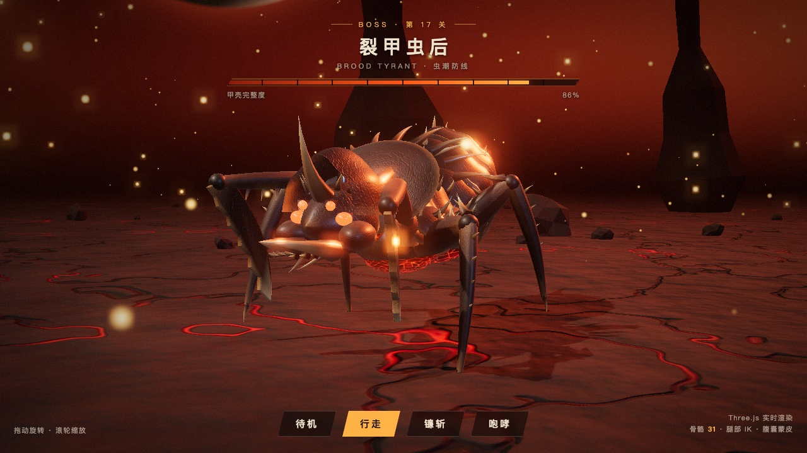
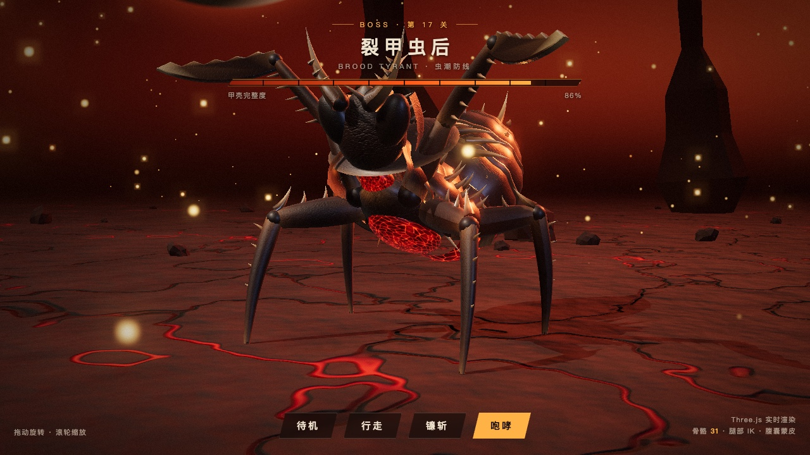
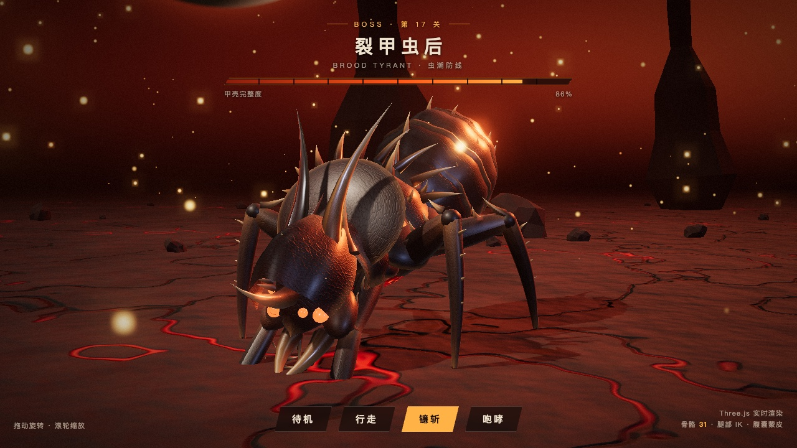
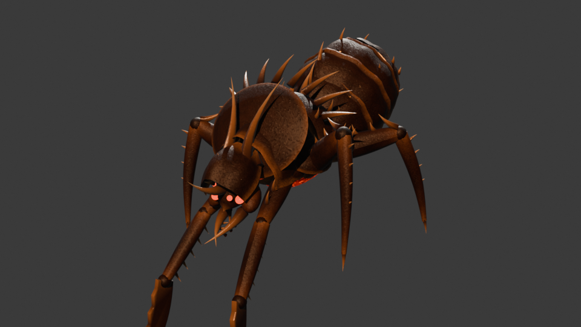
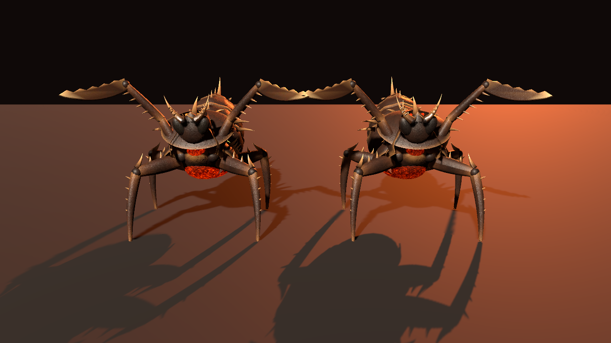

# threejs-to-3d-model

**用一句话描述，让 AI 写代码生成带骨骼动画的 3D 模型，直接导入 Unity / Unreal / Godot / Cocos / Web。**

An Agent Skill that turns a text description into a rigged, animated 3D model written as procedural Three.js code, then exports engine-ready GLB and FBX (with baked textures) via Blender.



| 咆哮 roar | 镰斩 attack |
|---|---|
|  |  |

「裂甲虫后（Brood Tyrant）」全部由 Three.js 代码生成，没有用任何建模软件：31 根骨骼、4 段动画（待机、行走、镰斩、咆哮）、腿部 IK、程序化甲壳纹理、熔岩发光。上图是 Chrome 实时渲染。

同一个模型走完流水线后，在 Blender 和 Unity 里的样子：

| Blender 烘焙后的 FBX | Unity 2022.3 导入（左 FBX，右 GLB） |
|---|---|
|  |  |

Unity 中与 Three.js 原动画逐帧比对骨骼位置，最大误差 GLB 约 1 µm、FBX 约 3 µm。

> 裂甲虫后是用这套流水线做的展示作品，代码不在本仓库里。模板自带的是一只较简单的示例甲虫（20 根骨骼、3 段动画），作为编写新生物的起点。

## 它能做什么

```
"做一只会走会攻击的四足甲虫"
        │
        ▼
 规格表（骨架、部件、动画、材质）──► 用户确认
        │
        ▼
 Three.js 代码：骨骼 + 部件 + 姿态函数 + IK
        │  真实 Chrome 导出
        ▼
 GLB ──► Khronos glTF Validator 校验
        │  Blender
        ▼
 FBX + 烘焙贴图（BaseColor / Normal / ORM）
        │
        ▼
 Unity 批处理导入，逐帧比对骨骼（可选）
```

- **文字即模型**：人物、怪物、生物、机甲、道具，用自然语言描述即可，Agent 按规格表写代码。
- **动作逐帧一致**：所有运动都是 `u ∈ [0, 1]` 的纯函数，预览、导出、参考采样共用一套代码。
- **引擎可用**：产物为标准 GLB 和 FBX，附 `manifest.json`（骨骼、动画、事件、误差）。
- **有验收**：glTF 校验 0 错误；Unity 2022.3 实测 FBX 和 GLB 骨骼误差都是微米级。

## 安装

一键安装（[skills](https://github.com/vercel-labs/skills) CLI，自动识别 Claude Code、Codex、Cursor 等 Agent）：

```bash
npx skills add duosheng/threejs-to-3d-model -g
```

或者手动克隆到你所用 Agent 的 skills 目录：

```bash
# Claude Code
git clone https://github.com/duosheng/threejs-to-3d-model ~/.claude/skills/threejs-to-3d-model

# Codex CLI
git clone https://github.com/duosheng/threejs-to-3d-model ~/.codex/skills/threejs-to-3d-model

# Cursor
git clone https://github.com/duosheng/threejs-to-3d-model ~/.cursor/skills/threejs-to-3d-model
```

然后对 Agent 说「生成一个会走会攻击的 3D 怪物模型」「把这个角色做成给 Unity 用的带动画 FBX」之类的话即可触发。

## 环境要求

| 工具 | 要求 | 说明 |
|---|---|---|
| Node.js | 18+ | 建工程时自动安装 three 0.170.0、playwright-core、gltf-validator |
| Google Chrome | 本机安装 | 导出和截图在真实 Chrome 中运行；其他路径用 `CHROME_PATH` 指定 |
| Blender | 4.2+ | 转 FBX、烘焙贴图；用 `BLENDER` 指定路径 |
| Unity（可选） | 2022.3 | 自动导入验证；用 `UNITY` 指定编辑器路径 |

## 手动使用

不经过 Agent 也可以直接用模板：

```bash
sh scripts/new_asset.sh ./my-creature
cd my-creature
npm start            # 浏览器预览，数字键切换动画
npm run shoot        # 截图到 out/screens/
npm run pipeline     # 导出 GLB → 参考采样 → FBX → 烘焙
npm run unity        # 可选：Unity 批处理导入并比对骨骼
```

只需修改 `src/creature.js`，写法见 [references/authoring.md](references/authoring.md)。

## 目录

```
SKILL.md                 Agent 读取的工作流与硬性规则
references/              规格模板、编写指南、流水线验收、各引擎导入要点
scripts/new_asset.sh     从模板创建工程
assets/template/         工程模板（rig-kit、示例生物、导出工具、Blender 脚本、Unity 检查）
```

## 验证状态

| 项目 | 状态 |
|---|---|
| macOS + Chrome + Blender 5.3 + Unity 2022.3 | 已实测 |
| Godot / Unreal / Cocos / Web 导入 | 给出了导入要点，未实测 |
| Windows / Linux | 路径可用环境变量配置，未实测 |

## License

[MIT](LICENSE)
